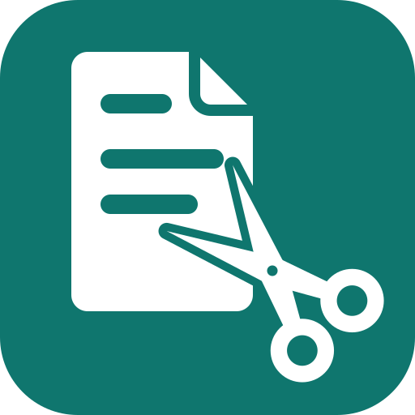

# Resume & CV Tailor

Tailor your resume or CV to one job. Paste the job description and your CV, and you get the CV rewritten for that role, plus a short list of the requirements it still doesn't cover, each with the one question that could fill it.

**Try it:** type `/tailor-my-cv`, paste the job posting after it and attach your CV. For example: `/tailor-my-cv Senior Customer Success Manager at a B2B software company. Posting below, CV attached.`

## What it does

- Matches every requirement in the posting to a line in your CV, or lists it as a gap
- Puts the results this job cares about first, using only numbers you can back up, so they hold up when an interviewer asks
- Replaces "helped with", "was involved in" and "approximately" with what you actually did and the exact figure, so each line shows your part
- Cuts what this job doesn't need, so the relevant lines aren't buried
- Keeps the layout ATS-safe: one column, standard headings, and no tables or graphics for applicant tracking software to scramble
- Writes a cover letter or application answers on request, from the same facts

Numbers are rounded honestly or not at all: 23% can become "over 20%", never 25%. Anything not yet confirmed is marked `[CONFIRM]` in the draft instead of being guessed.

## What it needs

The job description, pasted or as a file, and your current CV, pasted or as a PDF or Word file. Notes, a LinkedIn profile or interview stories help but are optional. No account or connector.

## Works with Job Interview Story Coach

Stories you build in [Job Interview Story Coach](https://github.com/angrysushi11/claude-plugins/tree/main/plugins/interview-story-coach) can become CV bullets here. Once the CV is done, the same examples carry into interview practice there.

## What it won't do

It won't invent experience, employers, titles, dates or numbers, round a figure up, or add a skill you can't back up. It doesn't research employers, submit applications or contact anyone. It can't promise an interview or a pass through any particular ATS.

## Data and privacy

The plugin is instructions only. It has no server, connector, account, database or telemetry, and it sends nothing to Will This Ever Work. Claude processes the job description, CV and answers you provide under your Claude account's terms and privacy settings. A CV holds personal data: share only what the task needs, and leave out ID numbers and other details the application doesn't ask for.

Privacy notice and support: https://www.willthiseverwork.com/plugins/privacy/ (support email: support@willthiseverwork.com).

## What is inside

The `resume-cv-tailor` skill, the `/tailor-my-cv` command, and two reference files: rewrite rules (bullets, numbers, ATS format, a fictional before-and-after) and cover letters and application answers.

## License

Apache License 2.0. See [LICENSE](LICENSE).
